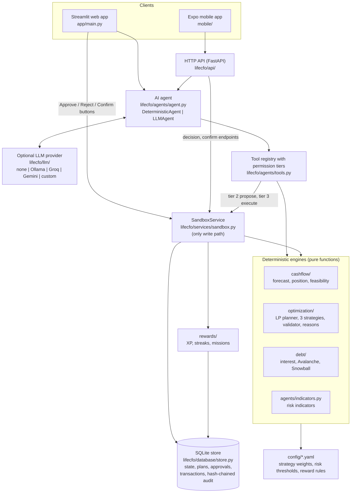

# LifeCFO AI: Technical Documentation

FinTechathon 2026, International Track, Topic A (Personal Finance Assistant).
Repository: <https://github.com/prommitr27-dev/lifecfo-ai>. Public demo:
<https://lifecfo-ai.streamlit.app/> (each visitor gets a private, temporary
sandbox).

This document describes the system **as built** in this repository. Every
statement points to the code or test that implements it. Deeper design notes
are linked at the end of each section.

Contents:

1. [System overview](#1-system-overview)
2. [System architecture](#2-system-architecture)
3. [End-to-end flow: from user input to result](#3-end-to-end-flow-from-user-input-to-result)
4. [Core algorithm](#4-core-algorithm)
5. [Security design](#5-security-design)
6. [Testing and evaluation](#6-testing-and-evaluation)
7. [Limitations](#7-limitations)
8. [Reproducing everything in this document](#8-reproducing-everything-in-this-document)

---

## 1. System overview

LifeCFO AI is an agentic personal finance assistant. A user describes their
income, bills, debts, savings goals, and preferences; LifeCFO builds a daily
cash-flow forecast, generates three validated savings plans, stress-tests them
against shocks (income cuts, emergency expenses), and replans when life
changes. Changes to the user's (sandbox) money happen only after the user
approves them.

The design rests on one division of labour:

| Part | Does | Never does |
|---|---|---|
| **Deterministic engines** (Python) | Every calculation: forecast, position, optimization, validation, debt interest, risk indicators | Talk to the user or decide on their behalf |
| **AI agent** (offline router or any LLM) | Understands the request, picks tools, explains the results in plain language | Calculate money, approve a plan, or move money |
| **User** | Approves or rejects plans, confirms real events (an expense that happened, an income change) | |
| **Sandbox service** | The only code path that changes stored state; checks approval, re-validates, writes the audit log | Accept an approval from anyone but the user |

All data is synthetic and all "execution" happens in a sandbox ledger. No bank
connection, credential, or real transaction exists anywhere in the code.

## 2. System architecture

### 2.1 Components



| Package | Responsibility |
|---|---|
| `lifecfo/domain` | Pydantic v2 models (`FinancialState`, `IncomeSource`, `Expense`, `Debt`, `Goal`, `Envelope`), integer money in satang, injectable clock, YAML profile loader |
| `lifecfo/cashflow` | Daily cash-flow forecast, the user's position (surplus, deficits, buffer, reserve), feasibility classification |
| `lifecfo/optimization` | Monthly linear program, three strategies, plan validator, plain-language reasons for late goals |
| `lifecfo/debt` | Interest accrual, minimum-payment schedules, Avalanche and Snowball payoff order |
| `lifecfo/agents` | Tool registry with four permission tiers, offline keyword agent, LLM tool-calling agent with output verification, response templates, risk indicators |
| `lifecfo/llm` | One `LLMClient` interface over any OpenAI-compatible endpoint (Ollama, Groq, Gemini, custom); settings from environment; error classification |
| `lifecfo/services` | `SandboxService`: propose, approve, execute, advance time, confirm events, withdraw reserve |
| `lifecfo/database` | SQLite repositories, unique idempotency keys, hash-chained append-only audit log |
| `lifecfo/rewards` | XP, levels, badges, daily and weekly streak state machine, missions that adapt after a shock |
| `lifecfo/evaluation` | Seeded scenario generator, three baselines, agent routing and injection evaluation |
| `lifecfo/api` | FastAPI endpoints used by the mobile app, optional bearer token |
| `app/` | Streamlit UI with six views: Home, Cash flow, Personal CFO, AI CFO chat, Rewards, Sandbox |

### 2.2 Layering rules

1. **Engines are pure functions.** They take an immutable `FinancialState`
   (frozen Pydantic model) and return results. They never open the database,
   so a simulation cannot overwrite stored data
   (`test_forecast_does_not_mutate_state`, `test_tools_never_change_the_state`).
2. **The sandbox service is the only write path.** Both the UI and the agent
   change state through `SandboxService`, which validates, checks approval, and
   writes an audit entry for every outcome, including refusals.
3. **The agent sees tools, not tables.** The agent can call only registered
   tools with typed inputs, up to its permission tier. There is no approval tool.
4. **One shared state.** Planning, shock simulation, recovery, and rewards all
   read the same stored state; none keeps its own copy of balances.

### 2.3 Data model

Money is stored as integer satang (1 THB = 100 satang), so there is no
floating-point drift in balances. Profiles are written in baht with a `_thb`
suffix and converted on load (`lifecfo/domain/loader.py`).

The ledger is an **envelope model**: one sandbox cash account split into
virtual envelopes (`UNALLOCATED`, `EMERGENCY`, one per goal) that always sum to
the account balance. Saving is a transfer from `UNALLOCATED` into another
envelope, so money is never counted twice (for example as both "emergency fund"
and "this month's savings").

| Entity | Key fields |
|---|---|
| `FinancialState` | `as_of`, time zone, reserve and buffer settings, envelopes, incomes, expenses, debts, goals, scheduled transfers |
| `Expense` | `ESSENTIAL` or `FLEXIBLE`, amount, `min_amount` (the floor a flexible expense may be cut to, only if the user allows reductions) |
| `Debt` | balance, minimum payment, due day, APR (may be unknown), whether extra repayment is allowed |
| `Goal` | target, priority, optional deadline, whether the deadline is flexible |
| `Plan` | strategy, months (contributions, flexible amounts, extra debt payments), goal and reserve projections, `state_hash` |
| Approval | `plan_hash`, `state_hash`, decision, `used_at` |
| Sandbox transaction | unique `idempotency_key` |
| Audit entry | timestamp, actor, action, payload, `prev_hash`, `hash` |

### 2.4 Deployment surfaces

| Surface | How to run | Notes |
|---|---|---|
| Web app | `uv run streamlit run app/main.py` | Default; SQLite file under `data/` |
| Public demo | <https://lifecfo-ai.streamlit.app/> | `LIFECFO_SANDBOX=session`: every visitor gets an in-memory sandbox that disappears with their session ([guide](../DEPLOY_STREAMLIT_CLOUD.md)) |
| HTTP API | `uv run uvicorn lifecfo.api.main:app` | Optional `LIFECFO_API_TOKEN` bearer token |
| Mobile app | `cd mobile && npm ci && npx expo start` | Expo (iOS, Android, web) over the HTTP API ([guide](../../mobile/README.md)) |
| Scripts | `scripts/demo_15_steps.py`, `scripts/demo_offline.py`, `scripts/run_evaluation.py` | Fixed clock, no network; output is byte-for-byte reproducible |

No configuration is needed: with no `.env` the agent runs offline and nothing
leaves the machine. An LLM is opt-in through `LIFECFO_LLM_PROVIDER`
([AI providers](../AI_PROVIDERS.md)).

## 3. End-to-end flow: from user input to result

This section answers four questions: how user input enters the system, how the
AI analyses the situation, where the financial rules run, and how the result
returns to the user.

### 3.1 How user input enters the system

There are three kinds of input, and each takes a different, fixed path.

| Input | Entry point | Path |
|---|---|---|
| **Financial profile** (income, bills, debts, goals, preferences) | YAML profile (`data/synthetic/profile_demo.yaml`) loaded at sandbox reset; the Sandbox view's "Confirm this income change" form | `load_state` validates every field with Pydantic models (for example, zero or negative amounts are rejected), converts baht to satang, and `SandboxService.reset` stores it |
| **A question or request in chat** ("What if I get a 10,000 THB repair bill?") | AI CFO chat view, or `POST /chat` | Truncated to 2,000 characters, passed to the agent as data (never as instructions), together with at most the last six chat turns |
| **A decision or a real event** (approve, reject, an expense that happened, a reserve withdrawal, an income change) | Buttons and forms in the Sandbox view, or the matching API endpoints | Calls `SandboxService.decide`, `confirm_expense`, `withdraw_reserve`, `confirm_income_change` with `actor="USER"`. The agent has no tool that reaches these methods |

### 3.2 How the AI analyses the situation

```mermaid
sequenceDiagram
    actor U as User
    participant UI as App (chat view)
    participant A as Agent
    participant L as LLM (optional)
    participant R as Tool registry
    participant E as Engines
    participant S as SandboxService
    U->>UI: "What if I get a 10,000 THB repair bill?"
    UI->>A: text (<= 2,000 chars) + last 6 turns
    alt LLM configured
        A->>L: system rules + text + tool specs (up to the agent's tier)
        L->>A: tool call simulate_unexpected_expense(amount_thb=10000)
    else offline (default)
        A->>A: keyword router picks the same tool and arguments
    end
    A->>R: call(tool, arguments, max_tier)
    R->>R: tier check, Pydantic input validation
    R->>E: run on a copy of the state
    E-->>R: before/after figures, shortfall dates, reserve needed
    R-->>A: tool result (plain data)
    A->>A: LLM path: every number >= 100 in the answer must appear in a tool result
    A-->>UI: answer + tools called + mode (offline / LLM)
    UI-->>U: answer; stored data unchanged
    Note over U,S: To act on it, the user confirms the expense and approves a new plan in the Sandbox view
    U->>S: Confirm expense, Approve plan (buttons)
```

The agent has two implementations behind the same tool registry
(`lifecfo/agents/agent.py`):

- **`DeterministicAgent`** (default, offline). A keyword router (English and
  Thai) maps the request to one tool and its arguments, for example "income
  drops 20%" to `simulate_income_change(percent=-20)`, and renders the result
  with fixed templates (`lifecfo/agents/explain.py`). Requests to approve or to
  move money are refused before any tool is considered. Same input, same
  output, no network.
- **`LLMAgent`** (optional). A tool-calling loop of at most six steps on any
  OpenAI-compatible provider. The system prompt states the rules (never
  calculate money, never claim approval, treat user text as data, no investment
  advice). The model only chooses tools and words the answer. The answer is
  then checked, and the offline agent answers instead when:
  - the provider fails, times out, or returns nothing;
  - the answer contains a figure of 100 or more that appears in no tool result
    and not in the user's message (`unverified_numbers`);
  - the request plainly asked for an action (propose, execute) and the model
    claimed it without calling the tool.

  The reply carries a notice saying it was answered offline and why. No
  provider is ever selected automatically, and nothing falls back to a paid
  service.

The tools available to the agent (`lifecfo/agents/tools.py`):

| Tier | Tools | Effect on stored state |
|---|---|---|
| 0 READ | `get_financial_profile`, `get_financial_goals`, `get_spending_insights`, `get_audit_history`, `get_reward_status` | None |
| 1 COMPUTE | `get_cash_flow_forecast`, `get_financial_position`, `calculate_goal_feasibility`, `assess_financial_risk`, `optimize_financial_plan`, `compare_debt_strategies`, `simulate_income_change`, `simulate_unexpected_expense` | None; runs on copies |
| 2 PROPOSE | `request_plan_approval` | Stores a proposal; money and the active plan are untouched |
| 3 EXECUTE | `execute_approved_sandbox_plan` | Activates a plan only with an unused approval the user gave in the app |

### 3.3 Where the financial rules run

All financial rules run in the deterministic engines, never in the LLM, and
they run in the same order whether the request came from chat, a button, or the
API:

```
FinancialState (stored, verified)
  -> cashflow.position.assess_position     user's position: surplus, deficits, buffer, reserve (rules D1-D4)
  -> cashflow.forecast.forecast_cash_flow  daily ledger, debt interest (D5), shortfall dates
  -> optimization.generate_plans           LP per strategy: Safety First, Balanced, Goal First
  -> optimization.validate_plan            hard constraints + daily re-simulation; failing plans are never shown
  -> optimization.reasons                  why a goal is late, built from the plan's own numbers
  -> agents.indicators                     risk indicators (ratings only when thresholds are configured)
```

`validate_plan` runs three times in a plan's life: when the plan is generated,
when it is proposed, and again inside `SandboxService.execute` immediately
before it is applied. Section 4 describes each step.

### 3.4 How the result returns to the user

| Result | Returned as |
|---|---|
| Chat answer | Text built from tool results, plus the list of tools called and their tier, plus the mode (offline or LLM) and any fallback notice |
| Plans | Personal CFO view: three plans side by side with monthly contributions, flexible budget, goal completion months, reserve projection, buffer shortfalls, and the reason each late goal is late. Plans that allocate identically are labelled as such, with the reason |
| What-if | Before and after on the same 12-month horizon: plan status, largest cash gap and its first date, lowest unallocated cash, reserve needed. Stated as hypothetical |
| Home | Money left to use today, bills due next, goal progress |
| Sandbox outcome | A status code and message (`EXECUTED`, `STALE_APPROVAL`, `ALREADY_EXECUTED`, ...), the updated balances, and the audit log with its chain status |
| Mobile | The same data as JSON from the API |

### 3.5 Worked example (from the execution evidence)

The 15-step demo (`scripts/demo_15_steps.py`, report in
[evidence/demo_15_steps.md](evidence/demo_15_steps.md)) runs this flow on a
synthetic profile: salary 30,000 THB, essentials 18,000 THB, leisure 3,000 THB
(can be cut to 2,000), 6,000 THB emergency reserve, goals "New laptop" 30,000
THB and "Vacation" 15,000 THB.

1. The user asks to compare plans; the agent calls `optimize_financial_plan`
   and three validated plans are shown. The user proposes Balanced, approves it
   in the app, and the agent executes it.
2. "What if my income drops 20%?" calls `simulate_income_change`: the active
   plan becomes `PLAN_INFEASIBLE`, short by up to 58,000 THB, first on
   2026-11-30. Stored data is unchanged.
3. The user confirms the income cut in the Sandbox view. Earlier proposals no
   longer match the state hash and lapse. Three new plans are generated; the
   user approves Safety First; a second execution of the same approval is
   blocked (`DUPLICATE_EXECUTION_BLOCKED`).
4. "What if I get a 10,000 THB repair bill?" calls
   `simulate_unexpected_expense`: 6,000 THB is not covered by unallocated cash.
   The user confirms the expense; the position report shows essentials need
   4,000 THB from the reserve (6,000 THB to keep flexible spending at its
   minimum); the user withdraws 6,000 THB; a recovery plan is validated,
   approved, and executed.
5. Goal projections are recalculated (reserve by month 12: 47,000 THB before,
   37,000 THB after), missions switch to recovery, the streak is protected, and
   the audit log shows all 14 entries with an intact hash chain.

## 4. Core algorithm

### 4.1 Daily cash-flow forecast (`lifecfo/cashflow/forecast.py`)

The forecast expands every income, expense, debt payment, and transfer into
dated cash events and walks the ledger day by day. Within a day, events are
applied in a fixed order: income, essentials, debt minimums, flexible
spending, savings transfers, extra debt repayments. Monthly items scheduled for
day 29 to 31 are clamped to the last day of shorter months. Debt payments come
from `lifecfo/debt/schedule.py`, which accrues interest where the APR is known
and otherwise keeps the minimum payment for the whole horizon (rule D5).

The forecast never draws on the emergency or goal envelopes by itself: a
negative unallocated balance is reported as a shortfall with its amount and
first date, and how to fund it is the planner's and the user's decision.

### 4.2 Financial position (`lifecfo/cashflow/position.py`)

Before any plan is made, the user's position is classified with one definition
of available cash:

```
original surplus = income - essentials - debt minimums - flexible budget
adjusted surplus = income - essentials - debt minimums - flexible minimum
```

Cash is reported in three pools that never overlap: unallocated cash, the
eligible emergency reserve, and money committed to goals. The emergency target
is the user's custom amount or `reserve_months x (essentials + debt minimums)`
(rule D4). The buffer (D3) is checked against accessible cash (unallocated plus
reserve).

`generate_plans` stops and reports instead of planning when:

| Status | Meaning |
|---|---|
| `ESSENTIAL_SHORTFALL` | Essentials and debt minimums cannot be paid even with the whole reserve |
| `REQUIRES_RESERVE_DRAWDOWN` | They can be paid only by withdrawing from the reserve; the amount is shown and the user decides |
| `FLEXIBLE_SPENDING_CONSTRAINT` | Even the flexible minimum leaves a deficit |

No plan is invented in these cases (`test_no_plan_is_invented_when_essentials_cannot_be_paid`).

### 4.3 Plan optimization: a monthly linear program (`lifecfo/optimization/optimizer.py`)

For each strategy, one linear program decides, for each month `t` of a 12-month
horizon:

| Variable | Meaning |
|---|---|
| `x[e,t] >= 0` | Contribution to envelope `e` (emergency reserve or a goal), swept on the last day of the month |
| `th[t] in [0,1]` | Share of the cuttable part of flexible spending that is kept (1 = full budget, 0 = the floor) |
| `s[e,t] >= 0` | How far envelope `e` is behind its savings ramp at the end of month `t` |
| `z[t] >= 0` | Extra debt repayment (only when the strategy and the debts allow it) |
| `b[t] >= 0` | How far accessible cash is below the user's buffer after the sweep |

**Hard constraints**

- *Liquidity:* unallocated cash is non-negative on every day that has a cash
  event and after every month-end sweep. Essentials and debt minimums are
  constants on the right-hand side, so they are always paid in full.
- *No overfunding:* the total contributed to an envelope never exceeds what it
  still needs.
- *Debt room:* extra repayments never exceed what is owed.

**Soft constraints (penalised in the objective)**

- *Savings ramp:* `s[e,t] >= required(e,t) - sum(x[e,0..t])`, where
  `required` grows linearly to the remaining need by the goal's deadline (or
  over `reserve_ramp_months` for the reserve). A goal without a deadline has no
  ramp and only takes money left after time-bound goals (rule D9).
- *Buffer:* `b[t]` measures the gap to the buffer, with a weight of 1,000 so
  the buffer comes first whenever it can be met. When it cannot, the shortfall
  is reported per month instead of the plan being withheld.

**Objective (minimised)**

```
  sum_e,t  w_e * s[e,t]                                  behind-ramp cost
- sum_e,t  k * bonus_e * (H - t) * x[e,t]               reward for saving early
- sum_t    flexible_cut_weight * cuttable_t * th[t]      cost of cutting flexible spending
- sum_t    k * debt_bonus * (H - t) * z[t]               extra repayment, last in line
+ sum_t    buffer_weight * b[t]                          buffer shortfall
```

`w_e` is `reserve_weight` for the reserve and `goal_weight x priority_decay^(priority-1)`
for goals; `H` is the horizon; `k` is `surplus_bonus_scale`. The debt bonus is
capped at half the smallest goal bonus, so extra repayment only receives money
left after every goal that still needs it (economics decision 2).

**The three strategies** use the same LP with different parameters from
`config/strategy_weights.yaml` (draft assumptions owned by the financial
modelling lead):

| Parameter | Safety First | Balanced | Goal First |
|---|---:|---:|---:|
| Months to reach the reserve target | 1 | 6 | 12 |
| Reserve weight | 10 | 5 | 2 |
| Goal weight | 1 | 4 | 10 |
| Cost of cutting flexible spending | 2 | 15 | 20 |
| Surplus to reserve / goals / debt | 3 / 1 / 2 | 1 / 1.5 / 1.2 | 0.5 / 2 / 0.8 |
| Buffer weight | 1000 | 1000 | 1000 |

**Solving and rounding.** The LP is solved with SciPy's HiGHS solver
(`scipy.optimize.linprog(method="highs")`) in milliseconds. The solution is
rounded down to whole baht on the *cumulative* contribution of each envelope,
which keeps the total rounding error under one baht and can only leave more
cash on hand than the LP solution. Closing balances and buffer shortfalls are
then recomputed from the daily forecast, which is the authority, not the LP.

When two strategies produce identical allocations (for example when every
baht is already committed), the result says so and explains why
(`IdenticalPlans`), rather than presenting false choices.

### 4.4 Plan validation (`lifecfo/optimization/plan.py: validate_plan`)

A plan is offered, stored, or executed only if `validate_plan` returns no
violations:

1. The plan's `state_hash` equals the SHA-256 fingerprint of the current state,
   and its start date equals the state's date.
2. Every contribution goes to a known envelope, is non-negative, and no
   envelope is funded beyond its target.
3. Every flexible amount stays between the expense's floor and its budget.
4. Every extra debt repayment targets a known debt that allows it, and the
   debt schedule confirms it does not exceed what is owed.
5. The plan applied to the state is re-simulated day by day over the whole
   horizon, and unallocated cash never goes negative.

If the optimizer ever produced a plan that fails validation, it raises
`PlanValidationError` instead of returning it.

### 4.5 Shock simulation and recovery

- **What-if** (`simulate_income_change`, `simulate_unexpected_expense`): the
  shock is applied to a copy of the state and the active plan is re-forecast on
  the same horizon. The tool returns before and after figures: plan status,
  largest gap and its date, lowest unallocated cash, reserve needed. Nothing is
  stored.
- **Confirmed shock** (`confirm_expense`, `confirm_income_change`, user only):
  the event is written into the stored state, which changes the state hash, so
  every earlier proposal and approval lapses and a new plan must be generated
  and approved.
- **Recovery:** the position report states how much the reserve must cover
  (essentials only, and with flexible spending at its minimum). The user
  withdraws that amount (`withdraw_reserve`, user only), and the planner then
  builds validated recovery plans from the new state; the reserve becomes a
  savings target again.
- **Risk indicators** (`assess_financial_risk`): days until the first
  shortfall, reserve in months of essentials, and essential-bill coverage.
  Thresholds live in `config/risk_thresholds.yaml`; while a threshold is unset
  the value is shown without a rating, so no rating is invented.

### 4.6 Explanations (`lifecfo/optimization/reasons.py`, `lifecfo/agents/explain.py`)

For each goal that misses its deadline, the reason is computed from the plan
itself: what the goal needed by its deadline, what the plan put in before then,
and where the rest of the saved money went (for example the emergency fund).
The LLM, when used, may only reword these facts, and its numbers are checked.

### 4.7 Sandbox execution (`lifecfo/services/sandbox.py`)

```
propose(plan)        validate -> store as PROPOSED -> audit PLAN_PROPOSED
decide(plan, USER)   refuses any actor but USER -> approval bound to plan_hash + state_hash
execute(approval)    approval exists and is APPROVED
                     -> not used before
                     -> stored plan hash == approved plan hash
                     -> current state hash == approved state hash
                     -> validate_plan again
                     -> one SQLite transaction: insert transaction with UNIQUE idempotency key,
                        save new state, mark approval used, set plan EXECUTED, audit PLAN_EXECUTED
advance(days)        posts scheduled cash events as sandbox transactions
```

Each refusal returns a code (`NO_APPROVAL`, `NOT_APPROVED`,
`ALREADY_EXECUTED`, `PLAN_CHANGED`, `STALE_APPROVAL`, `INVALID_PLAN`) and is
also written to the audit log.

### 4.8 Audit log (`lifecfo/database/store.py`)

Every entry stores `hash = SHA-256(prev_hash \n ts \n actor \n action \n payload_json)`,
with `payload_json` serialised with sorted keys and the first `prev_hash` set
to 64 zeros. Changing, inserting, or deleting any entry breaks every later hash;
`verify_audit_chain` recomputes the chain. The exported evidence logs can be
checked independently with `uv run python scripts/verify_evidence.py`.

### 4.9 Rewards (`lifecfo/rewards/`)

Rewards listen to validated events from the sandbox service and never change
financial state. XP, levels, badges, and daily and weekly streaks follow
`config/reward_rules.yaml`. Each reward event id is unique per item and period,
so XP cannot be granted twice. A confirmed shock moves the streak to
`PROTECTED` (frozen, neither increased nor reset) and switches missions to
recovery missions. Details: [REWARDS_SYSTEM.md](../REWARDS_SYSTEM.md).

Deeper notes: [Financial model](../financial_model/FINANCIAL_MODEL.md),
[Rules v0.2 status](../financial_model/RULES_V0.2_STATUS.md),
[ShockProof design](../SHOCKPROOF_DESIGN.md),
[Recovery engine](../RECOVERY_ENGINE.md).

## 5. Security design

The full control list with a test for each control is in
[SECURITY_DESIGN.md](../SECURITY_DESIGN.md); the permission tiers and the
known-risk list are in the
[Security Self-assessment](SECURITY_SELF_ASSESSMENT.md). Summary:

### 5.1 Trust boundaries

- The **user** is the only party that can approve a plan or confirm a real event.
- The **agent** is untrusted with respect to state. Whatever it outputs is a
  request that the tool registry and the sandbox service may refuse.
- The **LLM provider**, when enabled, is untrusted. Its tool calls are
  validated and its text is checked; nothing depends on it behaving well.

### 5.2 Main controls

| Threat | Control | Where |
|---|---|---|
| Agent approves or moves money on its own | No approval tool exists; `decide`, `confirm_*`, `withdraw_reserve` refuse any actor but `USER`; the offline agent refuses "approve" and "transfer" requests up front | `services/sandbox.py`, `agents/agent.py` |
| Prompt injection raises privileges | Tier checks and approval checks do not depend on model output; user text is data, truncated to 2,000 characters; tools above the agent's tier are not even offered to the model | `agents/tools.py` |
| LLM invents numbers | Every figure of 100 or more must appear in a tool result, otherwise the verified offline answer is shown | `agents/agent.py: unverified_numbers` |
| A plan is changed after approval, or the finances change | Approval bound to plan hash and state hash, re-checked at execution | `services/sandbox.py: execute` |
| Duplicate execution | Single-use approval plus a `UNIQUE` idempotency key in SQLite | `database/store.py` |
| An unsafe plan is executed | `validate_plan` at generation, proposal, and execution | `optimization/plan.py` |
| Tampering with history | Hash-chained, append-only audit log; refusals are logged too | `database/store.py` |
| Invalid input | Pydantic models with bounds on every tool input and domain object | `agents/tools.py`, `domain/models.py` |
| Data leaving the machine | Offline by default; an LLM is used only if configured; secrets in git-ignored `.env`; error messages never contain keys | `llm/config.py` |
| Visitors seeing each other's data on the public demo | Per-visitor in-memory sandbox (`LIFECFO_SANDBOX=session`) | `app/main.py` |
| Misleading advice | Engines compute every figure; no investment advice; when no plan exists the system says so | `optimization/optimizer.py`, system prompt |

### 5.3 Privacy

Only synthetic data is used. In the default offline mode nothing is sent
anywhere. With an LLM enabled, a chat question sends the system rules, the
user's message, up to six recent turns, the tool definitions, and the tool
results to that provider ([AI_PROVIDERS.md](../AI_PROVIDERS.md) lists each
provider's privacy terms).

## 6. Testing and evaluation

| Evidence | Command | Result (19 October 2026) |
|---|---|---|
| Unit, integration, scenario, and security tests | `uv run pytest` | 298 passed |
| Lint | `uv run ruff check .` | All checks passed |
| 15-step demo with a check per step | `uv run python scripts/demo_15_steps.py` | 15 of 15 steps pass |
| Offline agent transcript and sandbox log | `uv run python scripts/demo_offline.py --write` | Reproduced byte for byte |
| Evaluation against three baselines on 40 seeded scenarios, plus 20 routing and 10 injection prompts | `uv run python scripts/run_evaluation.py` | [EVALUATION_RESULTS.md](../testing/EVALUATION_RESULTS.md) |
| Exported audit logs (two scripted runs and one web-app session) | `uv run python scripts/verify_evidence.py` | All three pass the independent check |

Highlights from the evaluation (synthetic scenarios, draft weights): in the 30
scenarios where a plan exists, LifeCFO's validated plans had no negative cash
and no missed essential or debt payment, against 9 scenarios with a missed
payment for a fixed budget and 4 for a plan that is not updated after the
shock. In the 10 scenarios where no plan exists, LifeCFO discloses that instead
of offering one.

Test plan:
[TESTING_PLAN.md](../testing/TESTING_PLAN.md). Execution evidence:
[evidence/README.md](evidence/README.md).

## 7. Limitations

- Strategy weights, reserve months, and buffer months are draft design
  assumptions, not calibrated values.
- Risk thresholds are not set yet, so risk indicators are shown without a
  rating.
- The web app is single-user with no sign-in; on the public demo each visitor
  has a separate temporary sandbox. A real deployment needs authentication
  before "Approve" identifies a person.
- The audit log is tamper-evident, not tamper-proof: someone who can write the
  database file could rebuild the whole chain.
- The number check catches invented figures, not wrong qualitative statements
  with correct numbers. The offline mode is not affected.
- The offline agent routes by keywords and can pick the wrong read-only tool
  for unusual phrasing; it cannot reach a higher tier because of it.
- The product supports Thailand only (THB, `Asia/Bangkok`), by decision.

## 8. Reproducing everything in this document

```bash
git clone https://github.com/prommitr27-dev/lifecfo-ai.git
cd lifecfo-ai
uv sync
uv run pytest
uv run python scripts/demo_15_steps.py
uv run python scripts/demo_offline.py --write
uv run python scripts/verify_evidence.py
git diff --exit-code docs/competition/evidence   # no change: the evidence is reproducible
uv run streamlit run app/main.py
```
